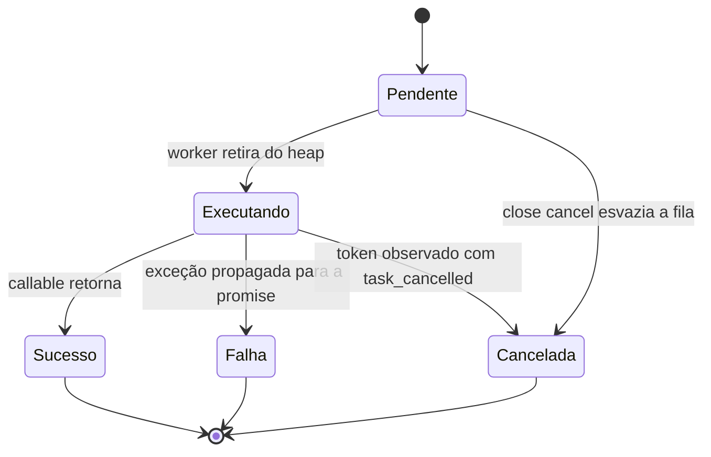

# Arquitetura e decisões

## Unidade de execução

O motor possui o estado compartilhado e um vetor de `std::jthread`. Cada tarefa é um `unique_ptr<Job>` que possui callable, tupla de argumentos, promise, prioridade, ID sequencial e fonte de cancelamento. O handle entregue ao produtor possui a future e uma cópia da fonte de cancelamento, cujo estado de parada é compartilhado pela biblioteca padrão.

A implementação do escalonador fica no `.cpp`; a parte dependente dos tipos submetidos fica no header. Isso permite retornar `TaskHandle<T>` com diagnóstico de compilação para assinaturas incompatíveis.

## Estados conceituais de uma tarefa aceita

Uma solicitação individual de parada não é um estado terminal. Se a tarefa ainda estiver na fila, a verificação ocorre ao retirá-la; a execução do callable é pulada e a promise recebe `task_cancelled`. Quando o callable já está ativo, ele decide onde observar o token. Retornar normalmente mantém o resultado e conta como sucesso.

## Propriedade e sincronização

| Recurso | Responsável | Sincronização |
| --- | --- | --- |
| Heap e capacidade | `State` | Mutex do estado |
| Contadores e aceitação | `State` | Mesmo mutex do heap |
| Callable e argumentos | `JobModel` | Um worker executa uma vez |
| Resultado/exceção | Promise/future | Sincronização da biblioteca padrão |
| Estado de parada | Cópias de stop_source/token | Sincronização da biblioteca padrão |
| Join das threads | `Engine` | Mutex de join separado |
| Detecção do próprio worker | Marca `thread_local` | Dado de cada thread |

Callables e seus destrutores são executados fora do mutex do estado. Solicitações de parada também ocorrem fora desse mutex, pois callbacks podem ser invocadas sincronamente. A resolução de promises pendentes ocorre antes da contabilização de seu cancelamento; não há API de continuação de usuário executada sob o lock.

O mutex de join permite que chamadas externas concorrentes de `shutdown` aguardem o mesmo conjunto de threads. O fechamento do estado ocorre antes de obter esse mutex, permitindo que um cancelamento posterior interrompa cooperativamente trabalhos enquanto outra chamada aguarda uma drenagem.

## Fila e garantias

Um heap máximo escolhe maior prioridade e, no empate, menor ID sequencial. O ID é atribuído na aceitação, sob o mutex. Isso ordena retiradas, não a conclusão de tarefas em threads distintas.

O vetor do heap reserva sua capacidade antes de iniciar os workers. O registro de controle, que pode alocar, é inserido antes de alterar a fila e o contador de aceitas. Rejeições de fila, timeout ou fechamento não produzem um handle de tarefa aceita.

A capacidade em número de tarefas não limita o tamanho dos objetos capturados. A implementação permite de 1 a 256 workers e de 1 a 1.000.000 posições pendentes, mas configurações pequenas são mais apropriadas para a demonstração.

## Encerramento e limites de vida útil

`close` impede novos trabalhos. O modo `drain` preserva a fila; `cancel` esvazia a fila, resolve as promises pendentes e solicita parada de tarefas ativas. O modo de cancelamento não pode ser revertido por uma chamada posterior de drenagem.

`shutdown` aguarda os workers. O destrutor usa cancelamento seguido de join e trata a propriedade das threads por RAII. A construção também sinaliza saída e aguarda as threads já criadas se a criação de outra thread falhar. Não há injeção de falhas de alocação ou de criação de threads na suíte atual.

Não é permitido destruir o motor em uma de suas próprias tarefas. Esse caso viola o contrato e chama `std::terminate` para evitar uma tentativa de join da própria thread. A destruição também não deve concorrer com chamadas de produtores usando o objeto.

O motor não consegue tornar seguro um callable que bloqueie para sempre, ignore cancelamento ou manipule referências que já perderam validade. Não há término forçado de threads. Esperas por dependências entre tarefas do mesmo pool precisam ser organizadas pelo chamador.

## Escolhas deliberadas

O projeto usa um único mutex para snapshots coerentes e um heap global para prioridade. Não há alegação de escalabilidade sem contenção. Work stealing exigiria rever a semântica de prioridade e o custo das métricas; não foi adicionado apenas para aumentar a complexidade.

Os testes usam gates, promises, latches e sinais explícitos. Não dependem de atrasos arbitrários para determinar a ordem de prioridade ou declarar que um cancelamento funcionou. O timeout do CTest atua como proteção externa contra travamentos.
